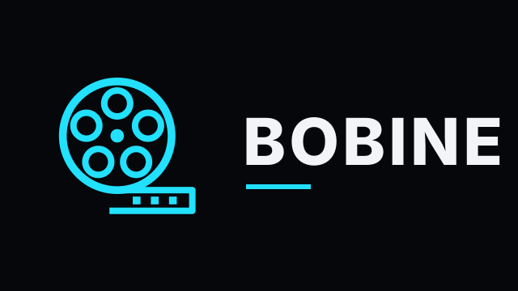

<p align="center"></p>

<p align="center">
  <b>Une interface moderne pour regarder ton serveur Jellyfin sur la TV, le PC ou la Xbox.</b><br>
  Télécommande, manette, tactile, clavier ou souris · Android TV · téléphone Android · Windows · navigateur
</p>

<p align="center">
  <a href="../../releases/latest">Télécharger</a> ·
  <a href="docs/installation-android-tv.md">Installer sur Android TV</a> ·
  <a href="docs/installation-windows.md">Windows</a> ·
  <a href="docs/installation-docker.md">Docker</a> ·
  <a href="docs/faq.md">FAQ</a> ·
  <a href="CHANGELOG.md">Nouveautés</a>
</p>

---

## C'est quoi, Bobine ?

[Jellyfin](https://jellyfin.org) est un serveur multimédia gratuit : tu y ranges tes films et tes séries, et tu les regardes depuis n'importe quel écran.

**Bobine est une autre façon de les regarder.** C'est une interface pensée d'abord pour la télévision : grandes affiches, navigation à la télécommande, bannière animée avec les bandes-annonces. Elle tourne aussi sur PC et sur Xbox.

- Bobine **ne remplace pas** Jellyfin : il te faut ton propre serveur Jellyfin, et Bobine s'y connecte.
- Bobine **ne fournit aucun contenu** : tu ne vois que ce qu'il y a sur ton serveur.
- Bobine **ne modifie pas** ton serveur : tes comptes, ta bibliothèque et tes réglages restent ceux de Jellyfin.

### Pour qui ?

- Tu as un serveur Jellyfin et tu trouves l'appli officielle Android TV austère.
- Tu veux parcourir tes films **tels que tu les as rangés en dossiers** (Action, Comédie…), pas seulement par genre.
- Tu gères un serveur pour ta famille ou tes amis et tu veux un **tableau de bord** et la **validation des demandes** depuis le canapé.

## Fonctions

| | |
|---|---|
| 🎬 **Accueil** | Bannière tirée au hasard dans toute ta bibliothèque, avec la bande-annonce en fond. Rangées « Reprendre », « À suivre », nouveautés et suggestions (« Parce que tu regardes… », « Réalisé par… »). |
| 📁 **Vue Dossiers** | Parcours tes films et tes séries selon l'arborescence de ton disque. |
| 🔎 **Recherche** | Résultats en direct, filtres rapides (pas encore vu, moins de 1 h 30, en famille, 4K) et **recherche vocale** (micro de la télécommande, ou micro du PC dans Chrome/Edge). |
| ▶️ **Lecteur** | Reprise exacte, **« Passer le générique »** (avec l'extension Intro Skipper), **épisode suivant automatique** avec compte à rebours, choix de la langue et des sous-titres. |
| 🧒 **Profil Enfants** | Ne montre que l'animation et les films familiaux. Sortir du profil demande un code parental. |
| 📊 **Tableau de bord** (administrateur) | Qui regarde en ce moment, analyse d'une bibliothèque, tâches planifiées, utilisateurs, appareils, extensions. |
| 🙋 **Demandes** (optionnel, avec [Seerr](https://github.com/seerr-team/seerr)) | Demander un titre absent de la bibliothèque, suivre ses demandes, **valider ou refuser celles des autres**. |
| 🌙 **Écran de veille** | Les images de ta bibliothèque en fondu, avec l'heure. |
| 🎮 **Commandes** | Télécommande Android TV, manette Xbox/PC, écran tactile, clavier et souris. |
| 🌍 **À la maison et dehors** | Deux adresses de serveur : Bobine prend toute seule celle qui répond. [En savoir plus](docs/acces-exterieur.md) |

## Ce qu'il te faut

- Un serveur **Jellyfin 10.9 ou plus récent**, accessible depuis l'appareil (réseau local ou Internet).
- Optionnel : l'extension **Intro Skipper** dans Jellyfin, pour le bouton « Passer le générique ».
- Optionnel : **Seerr** (ou Jellyseerr / Overseerr), pour les demandes.

## Installation en bref

| Appareil | Comment | Guide |
|---|---|---|
| Android TV, Google TV, box Android (Xiaomi, Nvidia Shield, Chromecast…) | APK à installer | [Guide Android](docs/installation-android-tv.md) |
| Téléphone et tablette Android | la même APK, qui s'adapte à l'écran tactile | [Guide Android](docs/installation-android-tv.md#sur-un-téléphone-ou-une-tablette) |
| Windows 10 / 11 | appli à installer ou version portable | [Guide Windows](docs/installation-windows.md) |
| Mac, Xbox, iPhone, n'importe quel navigateur | version web, hébergée avec Docker | [Guide Docker](docs/installation-docker.md) |

### Démarrage express avec Docker

```yaml
services:
  bobine:
    image: ghcr.io/windgui2771/bobine:latest
    restart: unless-stopped
    ports:
      - "8095:80"
    environment:
      JELLYFIN_URL: "http://192.168.1.10:8096"   # ton Jellyfin
      SEERR_URL: ""                              # optionnel
```

Ouvre ensuite `http://adresse-de-ton-serveur:8095` et connecte-toi avec ton compte Jellyfin.

## Commandes

| Action | Télécommande | Manette | Clavier |
|---|---|---|---|
| Se déplacer | flèches | croix / stick gauche | flèches |
| Valider | OK | A | Entrée |
| Revenir | Retour | B | Échap |
| Lecture / pause | Lecture | Start | Espace |
| Reculer / avancer | ◀◀ / ▶▶ | LB / RB | ← / → pendant la lecture |
| Recherche vocale | touche micro | — | — |

## Vie privée

Bobine ne parle qu'à **ton** serveur Jellyfin et, si tu l'as configuré, à **ton** Seerr. Seules exceptions :
- YouTube, pour les bandes-annonces (désactivable dans les réglages) ;
- Google Fonts, pour les polices ;
- TMDB, pour les affiches dans les demandes.

Aucune statistique, aucun compte Bobine, aucune publicité.

## Questions fréquentes

Voir la [FAQ](docs/faq.md) : appli officielle Jellyfin, lecture qui ne démarre pas, accès depuis l'extérieur, Play Store, mises à jour…

## Pour les développeurs

Voir [docs/developpement.md](docs/developpement.md) : structure du code, compilation de l'APK et de l'image Docker, publication d'une version.

## Licence

[MIT](LICENSE). Composants tiers : voir [THIRD_PARTY_NOTICES.md](THIRD_PARTY_NOTICES.md).

Bobine est un projet indépendant. Il n'est ni affilié à, ni soutenu par, les projets Jellyfin ou Seerr.
